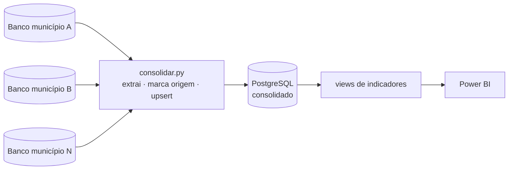

# 🗂️ Consolidação Multibanco PostgreSQL → Power BI

Ferramenta em Python que **unifica N bancos PostgreSQL com a mesma estrutura** (um por município/unidade) numa **base analítica única**, adicionando a coluna de origem e fazendo carga incremental idempotente. A base consolidada alimenta um painel de monitoramento em Power BI.

> Inspirado num painel real que construí para monitorar indicadores de sustentabilidade e racionalização de recursos em municípios. Aqui, estrutura de tabelas e dados são **genéricos e sintéticos**.


## O problema

Cada município opera **seu próprio banco** do sistema de processos eletrônicos, com tabelas idênticas. Para um painel estadual era preciso:

- juntar tudo sem perder a origem de cada registro;
- incluir novos municípios **só com configuração**, à medida que entram em produção;
- evitar que o Power BI abrisse dezenas de conexões diretas.

## A solução



- **Configuração declarativa** (`config/fontes.yaml`): adicionar um município = adicionar 4 linhas.
- **Chave composta** `(municipio, id_origem)` evita colisão de IDs entre bancos.
- **Upsert** (`INSERT … ON CONFLICT DO UPDATE`) → reexecutar não duplica dados.
- **Incremental** por `atualizado_em`, com marca d'água por município e tabela.
- **Falha isolada**: se um banco estiver fora, os demais continuam e o erro é registrado.

## Como executar

```bash
pip install -r requirements.txt
cp config/fontes.example.yaml config/fontes.yaml   # edite as conexões
psql "$DESTINO_URL" -f sql/schema_consolidado.sql
python src/consolidar.py --config config/fontes.yaml
```

Testes (sem banco):

```bash
pytest -q
```

## Indicadores (views em `sql/views_indicadores.sql`)

| View | Indicador |
|---|---|
| `vw_processos_por_municipio` | Processos abertos/concluídos por município e mês |
| `vw_tempo_medio_tramitacao` | Tempo médio de tramitação (dias) |
| `vw_documentos_digitais` | Documentos nato-digitais × digitalizados → economia de papel |

Exemplos de medidas DAX em [`docs/medidas-dax.md`](docs/medidas-dax.md).

---
Autor: [Carlos Absalão](https://www.linkedin.com/in/carlos-absalao-dados-ia) · Licença MIT
